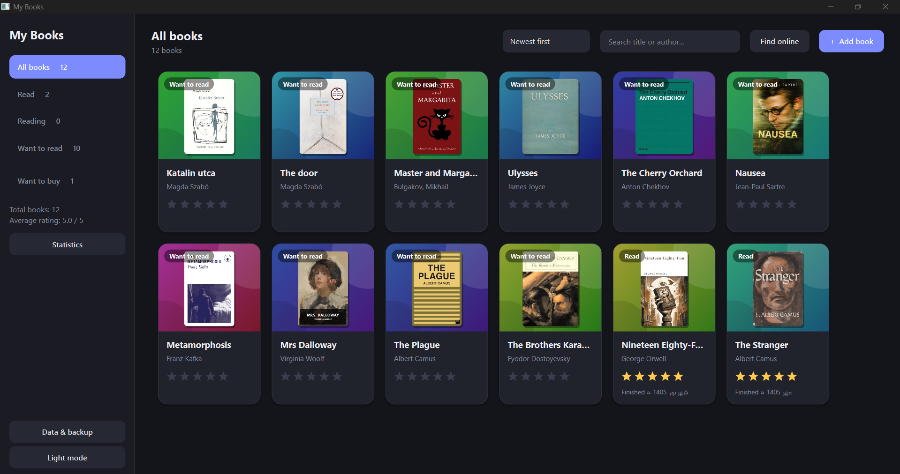
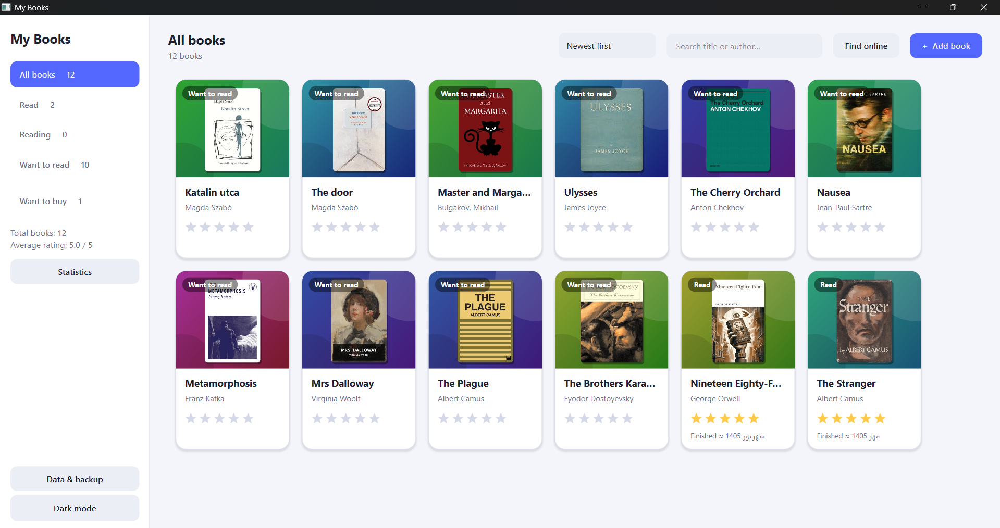

# Bookora – Personal Digital Library & Book Reading Tracker

**Your Personal Digital Library & Reading Companion**

Bookora is a desktop application built with Python and PySide6, designed to help readers organize their personal book collections, discover books online, track their reading progress, and explore their reading habits through statistics.

Whether you are building a personal library, keeping track of books you want to read, or exploring new titles, Bookora brings your reading collection together in one place.

## Features

### 📚 Personal Library Management
- Add, edit, and delete books.
- Organize books by reading status.
- Search and sort your personal collection.
- Add personal notes to individual books.
- Rate books from 1 to 5 stars.
- Right-click a book card for quick actions: edit, change its status or delete it.
- Deleted a book by mistake? Undo it right away (button or Ctrl+Z).

### 🔎 Online Book Discovery
- Search for books across multiple online sources.
- Integrated sources include Open Library, Google Books, Apple Books, Wikidata, and Taaghche.
- Search by book title and author.
- Filter and review search results.
- Identify books already in your library.
- Add discovered books directly to your collection or wishlist.
- Optional small cover previews in the results. They are kept in memory only; nothing is saved until you add a book.

### 📖 Reading Tracker
- Track reading status: Read, Reading, and Want to Read.
- Record reading start and completion dates.
- Monitor your reading activity.
- Support for Gregorian and Jalali calendars.
- Validate reading dates and maintain reading records.

### ⭐ Wishlist Management
- Maintain a separate list of books you want to purchase.
- Store book details, notes, and cover images.
- Move purchased books into your personal library.

### 📊 Reading Statistics
- Track yearly reading activity.
- Set annual reading goals.
- Visualize monthly reading progress.
- Calculate average book ratings.
- Explore frequently read authors.
- Review reading duration when date information is available.

### 🖼️ Book Cover Management
- Download book covers from online sources.
- Import cover images from your computer.
- Preview and manage book covers.
- Store cover images locally.

### 💾 Data Management
- Local SQLite database.
- Automatic and manual backups.
- Restore your library from backup files.
- Import and export book collections using CSV.
- Keep personal library data stored locally.

### 🎨 User Interface
- Dark and light themes, remembered between runs together with the sort order and window size.
- Book cards with large covers, colour-coded status labels and a smooth hover effect.
- Helpful empty screens, a warning before unsaved changes are lost, and short non-blocking messages.
- Persian digits for dates when the Jalali calendar is selected.
- Keyboard shortcuts.
- Responsive background tasks for online searches and image downloads.

## Application Preview

Bookora supports both Persian and English book collections, with dark and light interface themes.

### Persian Bookshelf


### English Bookshelf — Dark Mode



### English Bookshelf — Light Mode



## Tech Stack

| Technology | Purpose |
|---|---|
| Python | Core application |
| PySide6 | Desktop graphical interface |
| SQLite | Local database |
| REST APIs and web integrations | Online book discovery |
| CSV / JSON | Data exchange and settings |

## Installation

Bookora was tested with Python 3.12 and PySide6 6.12.

### 1. Clone the repository

```bash
git clone https://github.com/AliFazeli20/Bookora.git
cd Bookora
```

### 2. Create a virtual environment

```bash
python -m venv .venv
```

### 3. Activate the virtual environment

**Windows PowerShell:**

```powershell
.venv\Scripts\Activate.ps1
```

**Linux / macOS:**

```bash
source .venv/bin/activate
```

### 4. Install dependencies

```bash
python -m pip install -r requirements.txt
```

### 5. Run Bookora

```bash
python books_online.py
```

### Persian font (optional)

Bookora looks best with the free [Vazirmatn](https://github.com/rastikerdar/vazirmatn) font (SIL Open Font License). Either install it on your system, or put `Vazirmatn-Regular.ttf` and `Vazirmatn-Bold.ttf` in a folder named `fonts` next to `books_online.py`; the app loads them automatically. The `fonts` folder is excluded from version control.

## Keyboard Shortcuts

| Shortcut | Action |
|---|---|
| `Ctrl+N` | Add a book |
| `Ctrl+F` | Search your library |
| `Delete` | Delete the selected book (use `Ctrl+Z` to undo) |
| `Ctrl+Z` | Undo the last delete, while the Undo message is visible |
| `Ctrl+Enter` | Save, inside the book dialog |

## Data Storage

Bookora uses SQLite to store your library information locally.

Application settings, book covers, and backup files are maintained separately on your computer. The settings file can hold your optional Google Books key and contact email, so keep it private.

Personal databases, settings, and user data are excluded from version control through `.gitignore`.

## Project Structure

```text
Bookora/
│
├── books_online.py
├── requirements.txt
├── CHANGELOG.md
├── README.md
├── LICENSE
├── assets/
└── .gitignore
```

## Project Status

**Current version:** `0.2.0`

Bookora is an evolving personal project. New features, improvements, and refinements may be introduced in future releases. See [CHANGELOG.md](CHANGELOG.md) for what changed in each version.

Older versions stay available on the [Releases](https://github.com/AliFazeli20/Bookora/releases) page. Version 0.2.0 did not change the database format, so your library files work with both.

## Acknowledgements

Bookora integrates with several external book discovery sources. Their availability and data access methods are subject to the respective services and may change over time.

## License

Bookora is released under the [MIT License](LICENSE).

## Author

**Ali Fazeli**

GitHub: [@AliFazeli20](https://github.com/AliFazeli20)

---

*Built with Python and a passion for books.*
