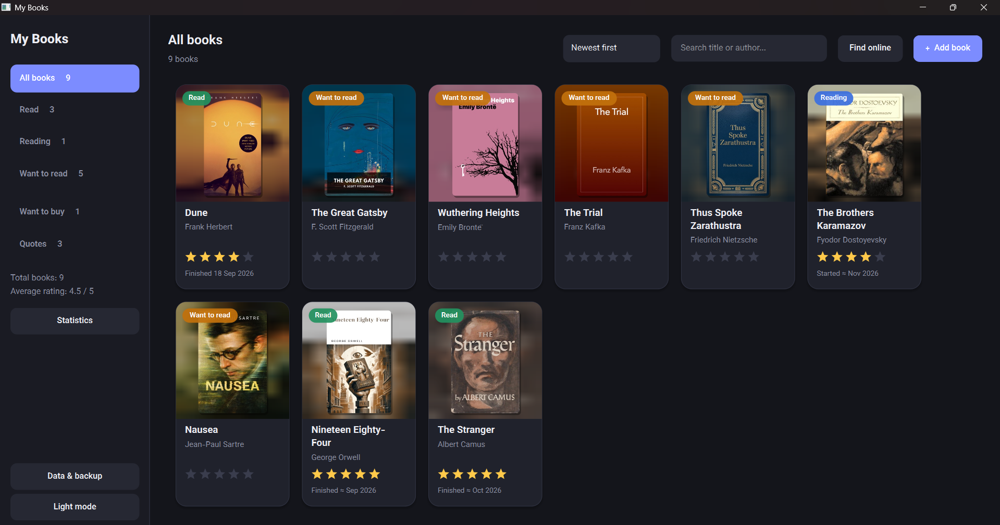
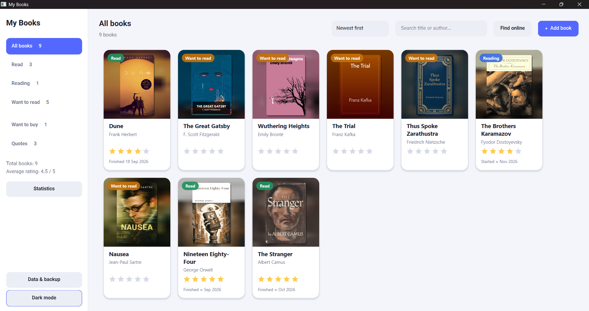
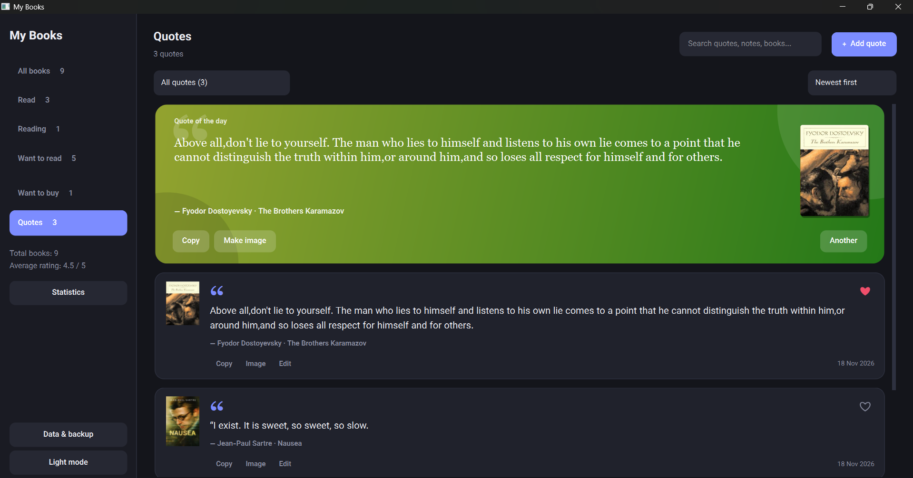
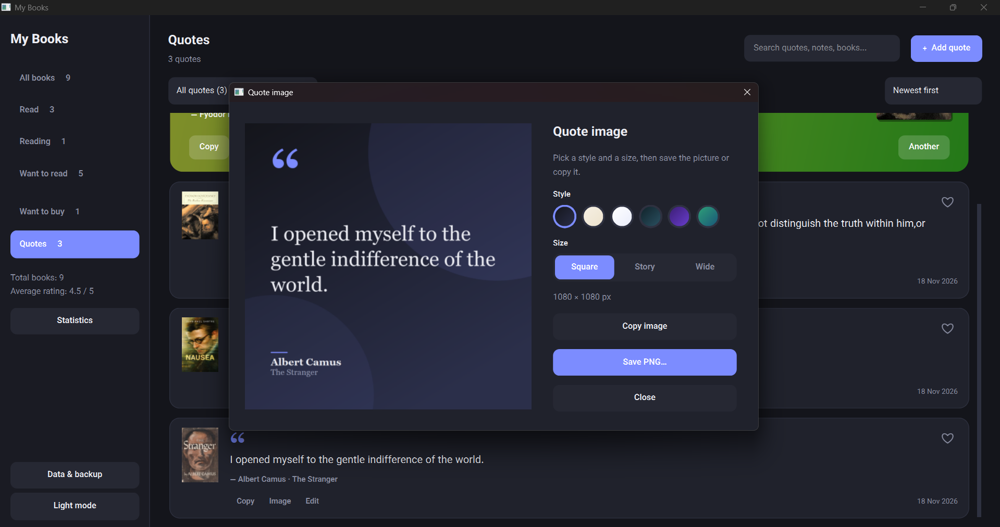

# Bookora – Personal Digital Library & Book Reading Tracker

**Your Personal Digital Library & Reading Companion**

Bookora is a desktop application built with Python and PySide6, designed to help readers organize their personal book collections, discover books online, track their reading progress, save the sentences they love, and explore their reading habits through statistics.

Whether you are building a personal library, keeping track of books you want to read, or collecting quotes from the books you finish, Bookora brings your reading life together in one place.

## Features

### 📚 Personal Library Management

- Add, edit, and delete books, with **Undo** after a delete.
- Organize books by reading status.
- Search and sort your personal collection.
- Add personal notes to individual books.
- Rate books from 1 to 5 stars.
- Right-click menu on every card for quick actions.

### 💬 Quotes

- Save the sentences you love from your books, each with the book, an optional page number, and your own note.
- **Quote of the day** at the top of the page, with an "Another" button.
- Mark favorites, filter by favorites or by a single book, and sort by date, book, or favorites.
- Search across quote text, notes, book titles, and authors.
- Copy a quote together with its author, book, and page.
- Make a **shareable image** of any quote: 6 styles, 3 sizes, copy it or save it as PNG.
- Import and export quotes as CSV.
- Full right-to-left support for Persian quotes, including verse.

### 🔎 Online Book Discovery

- Search for books across multiple online sources.
- Integrated sources include Open Library, Google Books, Apple Books, Wikidata, and Taaghche.
- Search by book title or author, and narrow a title search with the **"Only by author"** filter (Persian names work too).
- Filter and review search results.
- Identify books already in your library.
- Add discovered books directly to your collection or wishlist.

### 📖 Reading Tracker

- Track reading status: Read, Reading, and Want to Read.
- Record reading start and completion dates, exact or approximate (month, or year only).
- Monitor your reading activity.
- Support for Gregorian and Jalali calendars.
- Validate reading dates and maintain reading records.

### ⭐ Wishlist Management

- Maintain a separate list of books you want to purchase.
- Store book details, notes, and cover images.
- Move purchased books into your personal library.

### 📊 Reading Statistics

- Track yearly reading activity.
- Set annual reading goals.
- Visualize monthly reading progress.
- Calculate average book ratings.
- Explore frequently read authors.
- Review reading duration when date information is available.

### 🖼️ Book Cover Management

- Download book covers from online sources.
- Import cover images from your computer.
- Preview and manage book covers.
- Store cover images locally.

### 💾 Data Management

- Local SQLite database.
- Automatic daily backups and manual backups (database and covers).
- Restore your library from backup files.
- Import and export books and quotes using CSV (including Goodreads exports).
- Keep personal library data stored locally.

### 🎨 User Interface

- Dark and light themes, remembered between runs.
- Keyboard shortcuts.
- Custom book cards and search results.
- Responsive background tasks for online searches and image downloads.

### ⌨️ Keyboard Shortcuts

| Shortcut | Action |
|----------|--------|
| `Ctrl+N` | Add a book (or a quote, on the Quotes page) |
| `Ctrl+F` | Focus the search box |
| `Ctrl+Z` | Undo the last delete |
| `Delete` | Delete the selected book |
| `Ctrl+Enter` | Save in the book and quote dialogs |
| `Ctrl+Shift+Enter` | Save the quote and add another |

## Application Preview

Bookora supports both Persian and English book collections, with dark and light interface themes.
The books in these screenshots are demo data.

### Persian Bookshelf


### English Bookshelf — Dark Mode



### English Bookshelf — Light Mode



### Quotes



### Quotes in Persian (right-to-left)


### Shareable Quote Image



## Tech Stack

| Technology                     | Purpose                     |
|--------------------------------|-----------------------------|
| Python                         | Core application            |
| PySide6                        | Desktop graphical interface |
| SQLite                         | Local database              |
| REST APIs and web integrations | Online book discovery       |
| CSV / JSON                     | Data exchange and settings  |

## Installation

### 1. Clone the repository

```bash
git clone https://github.com/AliFazeli20/Bookora.git
cd Bookora
```

### 2. Create a virtual environment

```bash
python -m venv .venv
```

### 3. Activate the virtual environment

**Windows PowerShell:**

```powershell
.venv\Scripts\Activate.ps1
```

**Linux / macOS:**

```bash
source .venv/bin/activate
```

### 4. Install dependencies

```bash
python -m pip install -r requirements.txt
```

### 5. Run Bookora

```bash
python books_online.py
```

### Optional: Persian font

For the best Persian text, install the free [Vazirmatn](https://github.com/rastikerdar/vazirmatn) font,
or put `Vazirmatn-Regular.ttf` and `Vazirmatn-Bold.ttf` in a folder named `fonts` next to `books_online.py`.
Bookora loads it automatically.

## Data Storage

Bookora uses SQLite to store your library information locally (books, wishlist, and quotes).

Application settings, book covers, and backup files are maintained separately on your computer.

Personal databases, settings, and user data are excluded from version control through `.gitignore`.

When you upgrade to a new version, your existing library is migrated automatically and nothing is deleted.

## Project Structure

```
Bookora/
│
├── assets/              # README screenshots
├── books_online.py      # The whole application
├── requirements.txt
├── CHANGELOG.md
├── README.md
├── LICENSE
└── .gitignore
```

## Project Status

**Current version:** `0.3.0` — see the [changelog](CHANGELOG.md) for what changed in each release.

Bookora is an evolving personal project. New features, improvements, and refinements may be introduced in future releases.

## Acknowledgements

Bookora integrates with several external book discovery sources. Their availability and data access methods are subject to the respective services and may change over time.

## License

Released under the [MIT License](LICENSE).

## Author

**Ali Fazeli**

GitHub: [@AliFazeli20](https://github.com/AliFazeli20)

---

*Built with Python and a passion for books.*
